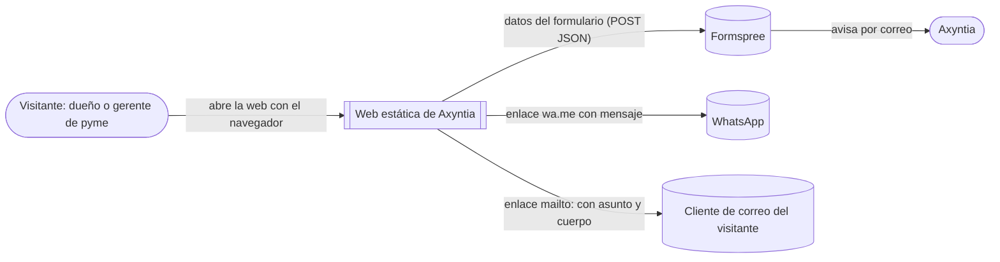
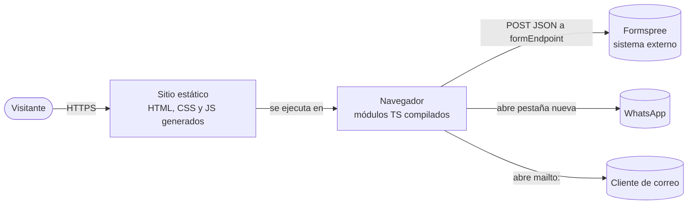
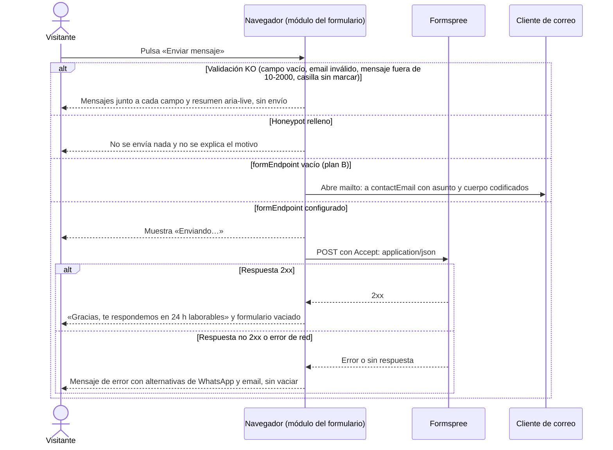

# Arquitectura de axyntia-web

## 1. Contexto y objetivos de calidad

Web corporativa de una sola página para Axyntia: un sitio estático que explica los servicios y permite contactar por formulario o WhatsApp. Qué se pide y para quién está en [el PRD](PRODUCT-REQUIREMENTS.md). Hoy el repositorio es el esqueleto técnico (una página «web en construcción», la configuración de contacto y un módulo de WhatsApp); la landing se construye en trabajos posteriores.

| Prioridad | Atributo de calidad | Objetivo medible                                             | Origen           |
| --------- | ------------------- | ------------------------------------------------------------ | ---------------- |
| 1         | Accesibilidad       | WCAG 2.2 AA; contraste ≥ 4,5:1                               | RNF-001, RNF-002 |
| 2         | Rendimiento         | Lighthouse móvil ≥ 90; JavaScript de cliente ≤ 60 KB gzip    | RNF-004, RNF-005 |
| 3         | Privacidad          | 0 peticiones a terceros al cargar; sin cookies ni analítica  | RNF-006, RF-036  |
| 4         | Responsive          | Sin scroll horizontal a 360, 768, 1024 y 1440 px             | RNF-003          |
| 5         | Mantenibilidad      | Gate en verde; configuración de contacto en un único archivo | RNF-011, RF-028  |

**Restricciones:** sin backend, sin base de datos, sin analítica, sin cookies (PRD sección 3). De la factoría: solo `pnpm` (12.10.1, campo `packageManager`); dependencias nuevas solo con `factory-dep` y versión exacta; licencias MIT, Apache-2.0, ISC, BSD-2/3-Clause o 0BSD; tests unitarios, de integración y e2e con Playwright; la factoría no despliega. `astro.config.ts` es ruta protegida.

## 2. Visión general

**Nivel 1: contexto**

**Nivel 2: contenedores**

| Contenedor                    | Responsabilidad                                                             | Tecnología                               | Datos que guarda                                |
| ----------------------------- | --------------------------------------------------------------------------- | ---------------------------------------- | ----------------------------------------------- |
| Sitio estático                | Entregar las páginas, los estilos, las fuentes y el JavaScript ya generados | Astro (salida estática), Tailwind CSS    | Ninguno                                         |
| Navegador (código de cliente) | Validar el formulario, enviarlo, animar el hero, menú móvil y apariciones   | Módulos TypeScript compilados, canvas 2D | Ninguno; los datos del formulario no se guardan |
| Formspree (externo)           | Recibir los mensajes y reenviarlos a Axyntia                                | Servicio de terceros                     | Mensajes de contacto (datos personales)         |

## 3. Pila tecnológica

| Capa               | Tecnología                                     | Versión                                                      | Por qué (o ADR)                               |
| ------------------ | ---------------------------------------------- | ------------------------------------------------------------ | --------------------------------------------- |
| Lenguaje / runtime | TypeScript y Node                              | typescript 6.0.3; `engines.node`: `">=24"`                   | ADR-001; ver ADR-006 sobre la versión de Node |
| Gestor de paquetes | pnpm                                           | 12.10.1                                                      | Regla de la factoría                          |
| Interfaz           | astro y tailwindcss con @tailwindcss/vite      | astro 7.4.12; tailwindcss 4.3.5; @tailwindcss/vite 4.3.5     | ADR-001                                       |
| Tipos de `.astro`  | @astrojs/check                                 | 0.9.12                                                       | `pnpm run typecheck`; ADR-006                 |
| Lint y formato     | eslint, prettier y prettier-plugin-astro       | eslint 10.15.0; prettier 3.10.1; prettier-plugin-astro 1.1.2 | ADR-006                                       |
| Datos              | Ninguno (Formspree externo para el formulario) | —                                                            | ADR-003                                       |
| Tests              | vitest y @playwright/test                      | vitest 5.1.1; @playwright/test 1.65.1                        | Regla de la factoría (3 tipos)                |

La CI usa la imagen `mcr.microsoft.com/playwright:v1.65.1-noble`, que coincide con la versión de `@playwright/test`.

## 4. Mapa del código

| Ruta                                           | Qué contiene y qué no                                                                                                                                             | Símbolos clave                                                                                         |
| ---------------------------------------------- | ----------------------------------------------------------------------------------------------------------------------------------------------------------------- | ------------------------------------------------------------------------------------------------------ |
| `src/config/`                                  | Datos públicos de contacto. Nunca secretos ni lógica.                                                                                                             | `site` (`companyName`, `siteUrl`, `contactEmail`, `whatsappNumber`, `whatsappMessage`, `formEndpoint`) |
| `src/lib/`                                     | Lógica pura probada en tests unitarios. Sin acceso al DOM.                                                                                                        | `buildWhatsAppUrl`                                                                                     |
| `src/pages/`                                   | Una página por ruta. Hoy `index.astro`; propuestos para la landing: `aviso-legal`, `privacidad`, `sitemap.xml.ts`, `robots.txt.ts`. No lleva lógica reutilizable. | `index.astro`                                                                                          |
| `src/styles/`                                  | CSS global y tokens en `@theme`. Ningún color o tamaño fuera de aquí.                                                                                             | `global.css`                                                                                           |
| `src/components/`, `src/scripts/` (propuestos) | Propuestos para el trabajo de la landing: componentes `.astro` y módulos TypeScript de cliente (formulario, menú, animación). No existen todavía.                 | —                                                                                                      |
| `tests/unit/`                                  | Tests unitarios de `src/lib/` y de lógica pura.                                                                                                                   | `whatsapp.test.ts`                                                                                     |
| `tests/integration/`                           | Compila el sitio de verdad y revisa el HTML y el CSS.                                                                                                             | `build.test.ts`                                                                                        |
| `tests/e2e/`                                   | Pruebas en navegador contra `astro preview`.                                                                                                                      | `home.spec.ts`                                                                                         |
| `.github/`                                     | CI (`workflows/ci.yml`), ruta protegida. No se edita sin David.                                                                                                   | `ci.yml`                                                                                               |
| `public/` (propuesto)                          | Archivos servidos tal cual: `fonts/` (woff2), favicon SVG e imagen para compartir de 1200×630 px. No lleva código ni datos de configuración.                      | —                                                                                                      |
| `docs/`                                        | PRD, ARCHITECTURE, DESIGN-SYSTEM, AI-AGENTS y `decisions/` (ADR).                                                                                                 | —                                                                                                      |

En la raíz: `astro.config.ts`, `vitest.config.ts`, `playwright.config.ts`, `pnpm-workspace.yaml` y `.npmrc` son configuración protegida (confirmado en sus comentarios; el resto de rutas protegidas es `[POR ACLARAR: resto de protected_paths en el factory.yaml de la factoría]`). `eslint.config.js` y `tsconfig.json` se cambian solo en un trabajo `test_config` aprobado por David (ADR-006). `dist/` y `.tmp-build-*/` son salidas ignoradas por git.

## 5. Flujo de datos

**Envío del formulario de contacto (HU-02)**

**Enlace de WhatsApp (HU-03):** `buildWhatsAppUrl(site.whatsappNumber, site.whatsappMessage)` limpia el número a dígitos, codifica el mensaje con `encodeURIComponent` y lanza un error si el número no tiene dígitos. El enlace se abre en pestaña nueva con `rel="noopener noreferrer"`.

**Compilación:** `astro build` genera el sitio estático en `dist/`; `src/config/site.ts` alimenta `site` de `astro.config.ts` y los datos de contacto de las páginas.

## 6. Invariantes

| ID     | Invariante                                                                        | Por qué                            | Cómo se comprueba                                                                                  |
| ------ | --------------------------------------------------------------------------------- | ---------------------------------- | -------------------------------------------------------------------------------------------------- |
| INV-01 | El documento declara `lang="es"`                                                  | RF-045, accesibilidad              | `tests/integration/build.test.ts` («genera index.html en español»)                                 |
| INV-02 | La página de inicio y las legales tienen un único `h1`                            | RF-003                             | `tests/integration/build.test.ts` (solo index.html; las legales, en el trabajo de la landing)      |
| INV-03 | Los colores de marca salen en el CSS generado                                     | Tokens aplicados de verdad         | `tests/integration/build.test.ts` («el CSS generado por Tailwind incluye…»)                        |
| INV-04 | `src/config/site.ts` no contiene secretos ni datos reales; solo marcadores        | RNF-009                            | Búsqueda de `formspree.io/f/` seguido de un identificador real (debe dar 0) y revisión de Security |
| INV-05 | 0 peticiones a terceros al cargar la página                                       | RNF-006                            | Prueba e2e que registra las peticiones: la añade el trabajo de la landing                          |
| INV-06 | Con `prefers-reduced-motion: reduce` no hay animación y el contenido está visible | RNF-008                            | Prueba e2e con `emulateMedia`: la añade el trabajo de la landing                                   |
| INV-07 | El enlace de WhatsApp se codifica y falla si el número no tiene dígitos           | RF-023, RF-025                     | `tests/unit/whatsapp.test.ts`                                                                      |
| INV-08 | No se usan GSAP ni three.js                                                       | ADR-004                            | Búsqueda de `gsap` y `three` en `package.json` (debe dar 0); revisión del Reviewer                 |
| INV-09 | Las dependencias son versiones exactas                                            | `saveExact` y regla de la factoría | `pnpm install --frozen-lockfile` en la CI y revisión de `package.json`                             |
| INV-10 | `formEndpoint` vacío o con prefijo `https://formspree.io/f/`                      | RNF-009                            | Prueba unitaria: la añade el trabajo de la landing                                                 |

## 7. Seguridad y datos

| Tema                         | Decisión                                                                                                                                                                                                                      |
| ---------------------------- | ----------------------------------------------------------------------------------------------------------------------------------------------------------------------------------------------------------------------------- |
| Datos personales             | Nombre, email, empresa y mensaje del formulario se envían a Formspree (tercero) cuando `formEndpoint` está configurado. `[APROBACIÓN DAVID]`. La web no guarda nada. Sin retención propia.                                    |
| Autenticación / autorización | No hay. Sitio público.                                                                                                                                                                                                        |
| Validación de entradas       | En el navegador (obligatorios, formato de email, mensaje de 10 a 2000 caracteres, casilla de privacidad, honeypot) y, además, la de Formspree. No se confía en ninguna de las dos para seguridad: el sitio no tiene servidor. |
| Secretos                     | Ninguno. `formEndpoint` es público por diseño. `PUBLIC_…` solo vale para valores públicos: un sitio estático no puede guardar secretos; si hiciera falta uno, exige backend y un ADR nuevo aprobado por David.                |
| Cabeceras y HTML             | CSP con `connect-src` limitado a Formspree y cabeceras de seguridad: pendientes hasta elegir hosting `[POR ACLARAR: hosting]`. En el cliente no se inserta HTML con datos del usuario (`textContent`, no `innerHTML`).         |
| Registro (logs)              | La web no registra nada: sin cookies ni analítica.                                                                                                                                                                            |
| Terceros                     | Solo Formspree (al enviar) y WhatsApp (al abrir el enlace). Fuentes autoalojadas (ADR-005).                                                                                                                                   |

## 8. Despliegue

- **Entornos:** local y producción. Staging: `[POR ACLARAR: hosting y entornos]`.
- **Construcción:** `pnpm run build` → carpeta `dist/` con el sitio estático.
- **Dónde corre:** `[POR ACLARAR: hosting]` · **Quién despliega:** David, fuera de la factoría.
- **Configuración por entorno:** `siteUrl`, `contactEmail`, `whatsappNumber`, `whatsappMessage` y `formEndpoint` en `src/config/site.ts`; y `PORT` para el e2e. Sin valores aquí.

## 9. Decisiones (ADR)

| ADR                                                                | Decisión                                                   | Estado    |
| ------------------------------------------------------------------ | ---------------------------------------------------------- | --------- |
| [ADR-001](decisions/ADR-001-sitio-estatico-astro-tailwind.md)      | Sitio estático con Astro, Tailwind v4 y TypeScript         | propuesta |
| [ADR-002](decisions/ADR-002-configuracion-centralizada-site-ts.md) | Configuración pública en un único archivo, sin secretos    | propuesta |
| [ADR-003](decisions/ADR-003-formulario-formspree-plan-b-mailto.md) | Formulario con Formspree y plan B `mailto:`                | propuesta |
| [ADR-004](decisions/ADR-004-hero-canvas-2d-sin-librerias.md)       | Animación del hero en canvas 2D sin librerías              | propuesta |
| [ADR-005](decisions/ADR-005-fuentes-autoalojadas-woff2.md)         | Fuentes woff2 autoalojadas                                 | propuesta |
| [ADR-006](decisions/ADR-006-lint-archivos-astro.md)                | P1: lint de `.astro` como hoy; plugin tras subir Node      | propuesta |
| [ADR-007](decisions/ADR-007-telemetria-astro.md)                   | P2: telemetría desactivada por variable en el gate y la CI | propuesta |
| [ADR-008](decisions/ADR-008-sitemap-robots-endpoints-estaticos.md) | P3: `sitemap.xml` y `robots.txt` como endpoints estáticos  | propuesta |

## 10. Alternativas descartadas

| Alternativa                       | Por qué se descartó                                                                 | Qué tendría que cambiar para reconsiderarla                                 |
| --------------------------------- | ----------------------------------------------------------------------------------- | --------------------------------------------------------------------------- |
| `@astrojs/sitemap`                | Exige tocar `astro.config.ts`, ruta protegida (ADR-008)                             | Un cambio de configuración aprobado por David y muchas páginas que mantener |
| GSAP                              | Licencia y peso (ADR-004)                                                           | Licencia permitida y presupuesto de JavaScript sobrante                     |
| three.js                          | Peso y dependencia nueva para un fondo decorativo (ADR-004)                         | Un ADR nuevo que lo justifique y la aprobación de `factory-dep`             |
| Fuentes desde Google Fonts        | Petición a un tercero con la IP del visitante (ADR-005)                             | Que RNF-006 deje de exigirse                                                |
| Backend propio para el formulario | Fuera de alcance: sin backend (ADR-003)                                             | Que el servicio externo deje de servir                                      |
| `robots.txt` en `public/`         | Dejaría `siteUrl` escrito a mano en la línea `Sitemap:` (ADR-008)                   | Que el dominio quede fijo y no cambie                                       |
| `eslint-plugin-astro` ahora       | Exige Node 24.16 o posterior y el equipo tiene 24.15.0 con `engineStrict` (ADR-006) | Subida de Node y un trabajo `test_config` aprobado por David                |

## 11. Complejidad justificada

| Complejidad añadida                        | Para qué                        | Alternativa más simple rechazada y por qué                  |
| ------------------------------------------ | ------------------------------- | ----------------------------------------------------------- |
| Módulos TypeScript de cliente (propuestos) | Formulario, menú y animación    | Solo HTML: no permite validar, enviar con estados ni animar |
| Canvas 2D propio                           | Hero atractivo sin librerías    | Imagen estática: no cumple la dirección visual pedida       |
| Endpoints de `sitemap.xml` y `robots.txt`  | Un único origen para el dominio | Archivos en `public/`: duplican el dominio                  |

## 12. Riesgos y deuda técnica

Puntos ya aceptados, sin decisión pendiente:

- **`sharp`:** aparece en el árbol solo como dependencia opcional de Astro y no se usa. `astro.config.ts` fija `passthroughImageService()` (sin transformar imágenes) y `onlyBuiltDependencies` está vacío.
- **Build del test de integración:** `tests/integration/build.test.ts` compila el sitio en una carpeta temporal `.tmp-build-*` dentro del proyecto, ignorada por git y borrada al terminar (`afterAll`), en vez de leer `dist/`.
- **Sin `/tmp`:** en el contenedor `/tmp` está en otro sistema de archivos y Astro mueve archivos con `rename`, lo que falla con el error EXDEV.

| Tipo   | Descripción                                                                           | Impacto                                | Plan                                                                 |
| ------ | ------------------------------------------------------------------------------------- | -------------------------------------- | -------------------------------------------------------------------- |
| deuda  | Los `.astro` no pasan por ESLint (Node 24.15.0 frente a 24.16 o posterior del plugin) | Menos comprobaciones en plantillas     | ADR-006: trabajo `test_config` aparte tras subir Node                |
| riesgo | Datos personales hacia Formspree                                                      | Obligaciones de privacidad             | `[APROBACIÓN DAVID]` y texto de privacidad (PRD, pregunta abierta 2) |
| riesgo | Telemetría de Astro en equipos de desarrollo                                          | Datos anónimos de uso a un tercero     | ADR-007: acción personal fuera del repositorio                       |
| deuda  | INV-05 e INV-06 no tienen aún test                                                    | Invariante sin comprobación automática | Los añade el trabajo de la landing                                   |
| deuda  | El e2e actual comprueba el título «Axyntia — web en construcción»                     | La landing lo cambiará                 | Lo actualizará el trabajo de la landing                              |

## 13. Glosario

| Término                | Significado                                             | Nombre en el código              |
| ---------------------- | ------------------------------------------------------- | -------------------------------- |
| Datos de contacto      | Configuración pública de la empresa                     | `site` en `src/config/site.ts`   |
| Destino del formulario | URL del formulario de Formspree; vacío activa el plan B | `formEndpoint`                   |
| Plan B                 | Envío por `mailto:` cuando no hay destino               | —                                |
| Enlace de WhatsApp     | URL `wa.me` con mensaje codificado                      | `buildWhatsAppUrl`               |
| Marcador               | Valor de ejemplo que David sustituye por el real        | `axyntia.example`, `34600000000` |
| Honeypot               | Campo oculto que solo rellenan los bots                 | —                                |
| Movimiento reducido    | Preferencia del sistema que pide menos animación        | `prefers-reduced-motion`         |
